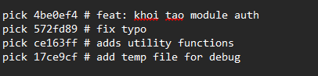
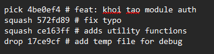
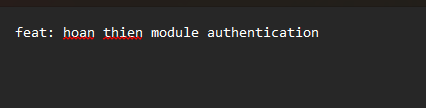
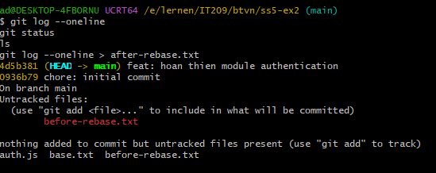

# Session 05 - Bài 2: Interactive Rebase: squash, reword và drop

## 1. Mục tiêu và tình huống

**Mục tiêu:** dùng `git rebase -i` để dọn dẹp lịch sử commit (gộp, đổi tên, loại bỏ commit) trước khi push.

**Tình huống:** trên nhánh tính năng, ngoài commit chính `feat: khoi tao module auth` còn có nhiều commit nhỏ, lộn xộn: `fix typo`, `adds utility functions`, `add temp file for debug`. Trước khi push, cần gộp các commit liên quan thành một commit có ý nghĩa và bỏ hẳn commit chứa file debug tạm.

## 2. Các bước thực hiện

### Bước 1: Khởi tạo repository với commit nền

```bash
git init -b main
echo "base" > base.txt
git add base.txt
git commit -m "chore: initial commit"
```

### Bước 2: Tạo 4 commit trên nhánh tính năng

```bash
# Commit 1: tạo module auth
echo "function login() {}" > auth.js
git add auth.js
git commit -m "feat: khoi tao module auth"

# Commit 2: sửa lỗi chính tả
echo "function logout() {}" >> auth.js
git commit -am "fix typo"

# Commit 3: thêm hàm tiện ích
echo "function hashPassword() {}" >> auth.js
git commit -am "adds utility functions"

# Commit 4: thêm file debug tạm
echo "debug" > temp.txt
git add temp.txt
git commit -m "add temp file for debug"
```

### Bước 3: Xem lịch sử trước khi rebase

```bash
git log --oneline
```

### Bước 4: Bắt đầu interactive rebase cho 4 commit gần nhất

```bash
git rebase -i HEAD~4
```

Git mở trình soạn thảo với danh sách todo của 4 commit, sắp xếp từ **cũ nhất đến mới nhất**.

## 3. Chỉnh sửa danh sách todo

**Trước khi chỉnh sửa** (mặc định tất cả là `pick`):

```text
pick 4be0ef4 feat: khoi tao module auth
pick 572fd89 fix typo
pick ce163ff adds utility functions
pick 17ce9cf add temp file for debug
```

**Sau khi chỉnh sửa:**

```text
pick 4be0ef4 feat: khoi tao module auth
squash 572fd89 fix typo
squash ce163ff adds utility functions
drop 17ce9cf add temp file for debug
```

Ý nghĩa các lệnh:

- **pick**: giữ nguyên commit.
- **squash**: gộp commit vào commit phía trên và cho phép soạn lại message chung.
- **reword**: giữ nguyên nội dung commit nhưng đổi commit message.
- **drop**: loại bỏ hoàn toàn commit (cùng các thay đổi của nó) khỏi lịch sử.

Sau khi lưu danh sách todo, Git mở tiếp trình soạn thảo để nhập message cho commit đã gộp. Toàn bộ message cũ được thay bằng:

```text
feat: hoan thien module authentication
```

## 4. Kết quả

Lịch sử **trước khi rebase** (`git log --oneline`):

```text
17ce9cf add temp file for debug
ce163ff adds utility functions
572fd89 fix typo
4be0ef4 feat: khoi tao module auth
0936b79 chore: initial commit
```

Lịch sử **sau khi rebase** (`git log --oneline`):

```text
4d5b381 feat: hoan thien module authentication
0936b79 chore: initial commit
```

3 commit được gộp thành một commit mới (`4d5b381`), commit `add temp file for debug` đã bị loại bỏ, còn commit nền `0936b79` giữ nguyên hash.

### Ảnh chụp màn hình


*Danh sách todo ban đầu khi mở `git rebase -i HEAD~4`.*


*Danh sách todo sau khi đổi thành pick, squash, squash, drop.*


*Soạn lại message cho commit gộp thành `feat: hoan thien module authentication`.*


*`git log --oneline` sau khi rebase chỉ còn 2 commit.*

## 5. Ghi chú

- **Rebase viết lại lịch sử:** các commit sau khi rebase có **hash mới**, khác với commit gốc.
- Vì vậy chỉ nên rebase những commit **chưa được push**.
- Nếu đã push, phải dùng force push (`git push --force-with-lease`) để ghi đè lịch sử trên remote. Việc này **rủi ro trên nhánh dùng chung**, vì có thể làm mất commit hoặc làm lệch lịch sử của người khác.
